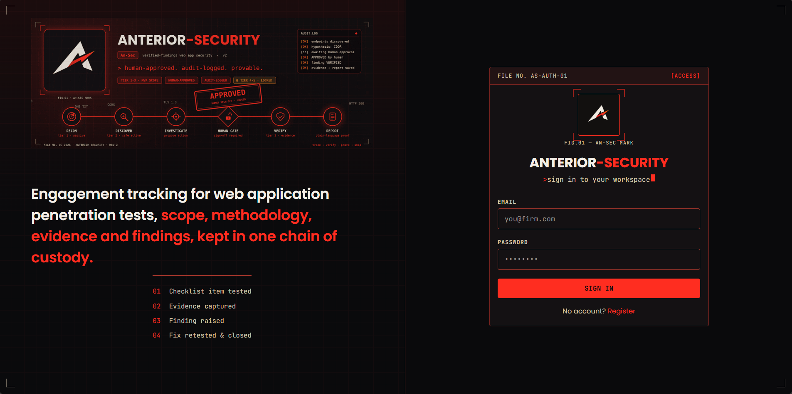
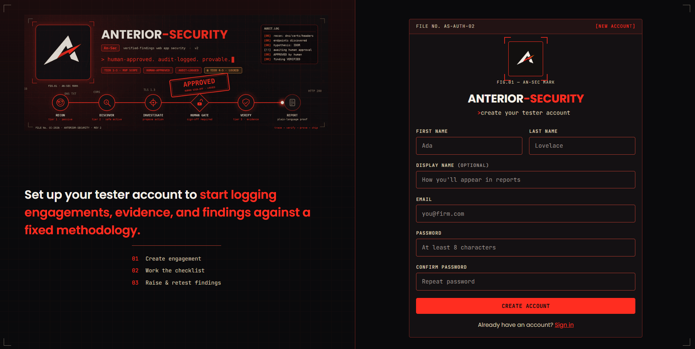
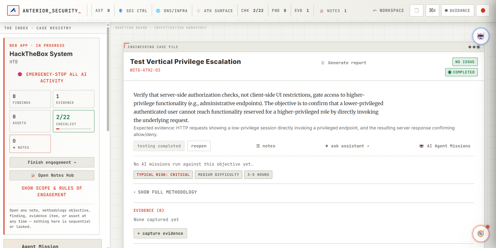
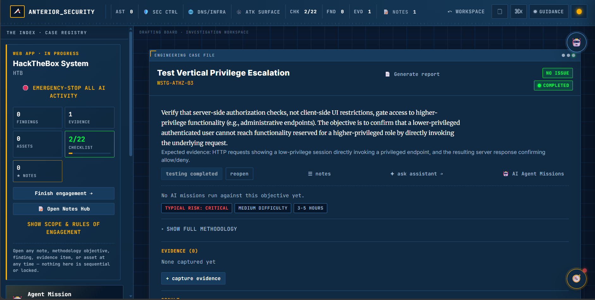

<!--
  THE DRAFTING ROOM x SECURITY CASE-FILE ARCHIVE — GitHub profile README
  Save as README.md in a repo named exactly like your username: chris-crts/chris-crts
  Palette: Black 0A0A0C · Charcoal 141113 · Crimson FF2D20 · Deep red 7A2420 · Ember FF7A00 · Amber FFB800 · Bone F3EDE4
-->

<div align="center">


<br/>


```text
┌──────────────────────────────────────────────────────────┐
│ [ OK ] blueprint engine ............................ ONLINE │
│ [ OK ] evidence archive ............................ MOUNTED │
│ [ OK ] human-approval gates ........................ ENFORCED │
│ [ >> ] awaiting collaboration request ...  ▮                │
└──────────────────────────────────────────────────────────┘
```


</div>

---

## `SUBJECT PROFILE`

```text
╔═ FILE No. CC-2026 ═══════════════════════════════
║ NAME        Christopher Cortes
║ FOCUS       Secure web apps · AI integration · Security tooling
║ EXPERIENCE  4+ years freelance · 10+ shipped projects
╚══════════════════════════════════════════════════
```

I build web and mobile applications where **security is part of the design, not an afterthought**: role-based access, audit trails, tamper-evident records, and human-approved automation.

My current focus is **Anterior-Security**, a verification-first security testing platform for small teams and independent developers.

Right now I'm designing security tooling for the people big vendors overlook: **solo developers and small teams shipping AI-assisted or no-code web apps**, who need *verified* findings in plain language, not a 200-item scanner dump.

---

## `ACTIVE INVESTIGATION` · Featured Case

<div align="center">


</div>

### Overview

**Anterior-Security (An-Sec)** is a verification-first web application security testing platform built for small teams and independent developers who ship AI-assisted and no-code applications. Rather than producing a long scanner report, it returns a small number of **verified, evidence-backed findings**, each explained in plain language and traceable through a complete audit trail that can serve as proof of due diligence.

The platform is designed around one principle: **no action runs without authorization, and no active test runs without a human decision.**

- **Authorized targets only.** Ownership is proven through a DNS TXT record or a `/.well-known/` verification file, and is re-checked on a schedule and before every active run. A lapsed verification suspends the target and invalidates existing approvals.
- **A single authorization chokepoint.** Every action is an `ActionProposal` that must move from `PROPOSED` to `APPROVED` by a human before it can execute. No code path can create a pre-approved proposal, and AI-originated proposals can never approve themselves.
- **Deterministic dispatch checks.** Emergency stop, target verification, engagement status, scope, the forbidden-action list, human approval, rate limits and isolation are evaluated in a fixed order on every run, and every failure is logged with its reason.
- **Evidence over alerts.** Findings are linked to immutable evidence records and presented with plain-language summaries and technical detail side by side.

| Tier | Capability | Authorization |
|---|---|---|
| 1 | Passive reconnaissance: DNS, certificate transparency, HTTP probing, security headers, technology fingerprinting | Rule-based, no approval |
| 2 | Safe active discovery: scoped crawl, endpoint and parameter discovery, CORS, cookie and HTTP method inspection | Rule-based, rate-limited and scope-checked |
| 3 | Verification of broken access control (IDOR), exposed secrets and misconfigured headers, and permissive CORS | Explicit human approval per proposal |
| 4-5 | Exploitation and post-exploitation | Hard-disabled in code; schema only |

Destructive writes, credential brute force, denial-of-service-style load, exfiltration of real user data, and any action outside scope or against an unverified target are permanently forbidden and cannot be enabled through configuration.

## 📸 Anterior Security Screens

[← Previous](#app_dash) | [Next →](#register_page)







```text
╔═ CASE FILE №001 ═══════════════════ [ PRIVATE REPO · v2 ]
║ CODENAME    ANTERIOR-SECURITY (An-Sec) — Verified-Findings Platform
║ OBJECTIVE   Verified findings, explained in plain language,
║             with proof the owner can show a client or auditor.
║ AUDIENCE    Indie SaaS builders · small agencies · AI/no-code
║             app makers without a dedicated security team
║ METHOD      Recon → Discover → Investigate → Verify → Report
║ CONTROLS    Verified ownership · scoped, rate-limited actions
║             · human sign-off · emergency stop · audit log
║ EVIDENCE    Immutable evidence records · traceable findings
║             · plain-language reporting
║ STACK       Python · Django · FastAPI · PostgreSQL · React · LLM APIs
╚═══════════════════════════════════════════════════════
```

---

## `FIELD KIT` · Instruments

<div align="center">


</div>

---

## `OPEN A CHANNEL`

<div align="center">

[](https://chris-crts-page.netlify.app/)
[](https://www.linkedin.com/in/christopher-cortes-a0021a28b/)
[](mailto:11corteschristopher@gmail.com)


</div>
